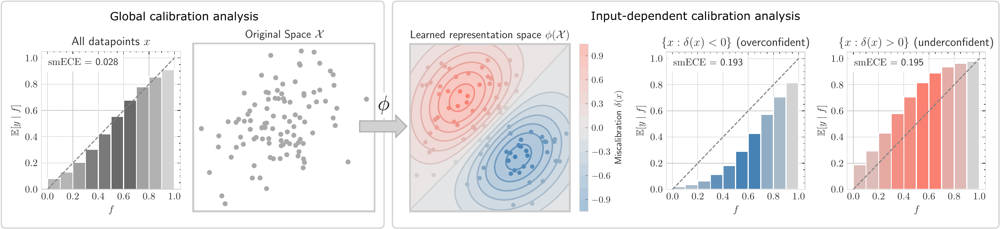

# Miscalibration Fields

[](https://arxiv.org/abs/2605.13484)


[](LICENSE)

Reference implementation of [*Miscalibration Fields: Revealing Local Structure in Model Calibration*](https://arxiv.org/abs/2605.13484).




A model can look well calibrated in aggregate while being **overconfident on some inputs and
underconfident on others**, with the errors cancelling out. The *miscalibration field*

```
δ(x) = E[ Y − f(X) | X = x ]
```

makes that structure explicit. Here `f(x)` is the model's confidence and `Y ∈ {0, 1}` is whether
it was correct. `δ(x) < 0` means the model is overconfident near `x`, and `δ(x) > 0` means it is
underconfident. This package learns a representation `φ(x)` in which kernel-averaging the residuals
`y − f(x)` of observed predictions gives an estimate `δ̂φ(x)`. It needs only `(x, f, y)` triples:
no predefined groups and no notion of which inputs should behave alike. The estimated field can
then be used to

* find regions of over- and underconfidence that aggregate diagnostics hide, and
* correct confidence locally, which confidence-only recalibration (temperature scaling, isotonic
  regression) cannot do.

## Installation

```bash
git clone https://github.com/kasia-kobalczyk/miscalibration-discovery.git
cd miscalibration-discovery
pip install -e .                 # core package
pip install -e ".[notebooks]"    # + Jupyter, for the notebooks
pip install -e ".[llm]"          # + transformers / accelerate to extract LLM confidences and embeddings
```

Requires Python ≥ 3.10. Training on the synthetic data runs comfortably on a CPU. Extracting LLM
embeddings needs a GPU.

## Getting started

| Notebook | What it shows | Runtime |
|---|---|---|
| [`notebooks/01_quickstart.ipynb`](notebooks/01_quickstart.ipynb) | End to end on synthetic data with a known field: train φ, recover the field, find over- and underconfident regions, correct confidence locally. | ~1 min, CPU |
| [`notebooks/02_llm_case_study.ipynb`](notebooks/02_llm_case_study.ipynb) | The same analysis for Qwen3-8B-Base judging HH-RLHF response pairs, including which kinds of dialogue end up in each region. | GPU for the extraction step |

## Using your own model

You need three things per example:

| column | shape | meaning |
|---|---|---|
| `emb` | `(d,)` float | a representation of the input, e.g. a hidden state of the model |
| `f` | scalar in `[0, 1]` | the model's confidence |
| `y` | `0` or `1` | whether the prediction was correct |

Save them as a Hugging Face dataset under `datasets/<name>` and train on it:

```python
from datasets import Dataset
Dataset.from_dict({"emb": emb, "f": f, "y": y}).save_to_disk("datasets/my_model")
```

```bash
python -m calib_atlas.train +data.path=my_model ++model.in_dim=<d> ++device=cuda:0
```

Then estimate the field for any split:

```python
from calib_atlas.field import load_run, make_run_loaders, estimate_field

phi, cfg = load_run("outputs/my_model/<run_name>", device="cuda:0")
loaders = make_run_loaders(cfg)                    # same train/val/test split as training
test = estimate_field(phi, cfg, bank_loader=loaders["train"], query_loader=loaders["test"])
test["hat_delta"]                                  # field estimate per test example
```

Datasets are read from `./datasets` by default. Set `CALIB_ATLAS_DATA=/some/dir` to keep them
elsewhere. `data.path` may also be an absolute path.

**Hyperparameters.** The two that matter most are the kernel bandwidth `loss.sigma` and the
mass regularizer `loss.lambda_mass`. Choose them on the validation split by the corrected Brier
score (`val/corrected_bs_score`, logged at every epoch and used for checkpoint selection);
`bin/run_models.sh` and `bin/find_best_run.py` automate this for the LLM setting.

## Repository layout

```
src/calib_atlas/
    train.py                    # Hydra entry point: trains φ
    field.py                    # load a trained run, estimate δ̂φ on any split
    models/phi_mlp.py           # MLP representation φ (also used by the residual-regression baseline)
    models/baselines.py         # temperature scaling; kernel smoothing in the raw embedding space
    losses/kernel_calib.py      # representation-learning objective
    losses/baseline_calib.py    # residual-regression baseline objective
    data/datamodule.py          # train/val/test loaders with a seeded, deterministic split
    data/dataset.py             # loaders for the LLM datasets (HH-RLHF, MMLU, MMLU-Pro, MedMCQA, ...)
    data/generate_real_data.py  # extract (embedding, confidence, correctness) from a Hugging Face LLM
    data/generate_synthetic_data.py  # synthetic datasets with a known field
    utils/eval_utils.py         # field estimation, local correction, smECE / ECE, reliability plots
    utils/label_perm.py         # label permutation for the null audit

configs/
    config.yaml                 # representation learning (default)
    config_resreg.yaml          # residual-regression baseline

bin/                            # experiment pipeline for the LLM study (see below)
notebooks/                      # tutorials (see above)
```

Each training run writes `best_phi.pt` and its full resolved config (`.hydra/config.yaml`) to
`outputs/<dataset>/<run_name>/`. For the LLM datasets that is `outputs/<dataset>/<model>/<run_name>/`.
Weights & Biases logging is off by default; enable it with `++wandb.enabled=true`.

## Reproducing the experiments

### Synthetic data

```bash
# Three Gaussian clusters that are over-, well- and under-confident by construction
python -m calib_atlas.data.generate_synthetic_data clusters

# Smooth sinusoidal fields over a grid of amplitudes A and frequencies k
python -m calib_atlas.data.generate_synthetic_data sinusoid --A 0.2 0.4 0.6 0.8 1.0 --freq 1 2 3 4 5

# Learn φ
python -m calib_atlas.train +data.path=synthetic_field_sinusoid_A0.6_freq3 \
    ++model.in_dim=2 ++loss.sigma=0.1 ++loss.lambda_mass=1e-3 ++device=cuda:0

# Residual-regression baseline: regress y − f directly on x
python -m calib_atlas.train --config-name=config_resreg data.path=synthetic_field_sinusoid_A0.6_freq3
```

Every synthetic dataset stores the ground truth (`eta = P(Y=1 | x)`, so the true field is `eta − f`),
so recovery can be measured directly; see `notebooks/01_quickstart.ipynb`.

### LLM study

Twelve base LLMs (Qwen3, Gemma 3, Llama 3.x, Ministral 3) on four datasets
(`hhrlhf_judge`, `mmlu`, `mmlu_pro`, `medmcqa`). The scripts in `bin/` launch runs in parallel
`tmux` sessions. Edit the model and pair lists at the top of each script. If you use conda,
set `CONDA_ENV=<env>` so each session activates it.

**1. Extract confidences and embeddings** for each (dataset, model) pair:

```bash
python -m calib_atlas.data.generate_real_data --dataset hhrlhf_judge --model_name Qwen/Qwen3-8B-Base
```

This writes `datasets/<dataset>/<model>/probas.jsonl` (confidence per example),
`datasets/<dataset>/<model>/embeddings/` (last-token hidden state of the prompt), and
`embeddings/config.json` (embedding size). For multiple-choice datasets the confidence is the
probability of the top-ranked option. For `hhrlhf_judge` the model judges which of two responses
is better and the confidence is the probability it gives to response A. Model and dataset
downloads use the standard Hugging Face caches; pass `--hf_hub` / `--hf_dataset_cache` to override.

**2. Sweep σ × λ** for every model on a dataset, then **select** the best run per pair by the
validation proxy:

```bash
bash bin/run_models.sh hhrlhf_judge --device cuda:0
bash bin/identify_best_runs.sh      # writes outputs/<dataset>/<model>/best_run.json
```

**3. Evaluate.** For each model, fit the local correction and the confidence-only baselines on
the validation split, then report smECE and Brier score on the test split, overall and within the
over-, well- and underconfident regions:

```bash
python bin/generate_ece_table.py --dataset hhrlhf_judge --device cuda:0
# bootstrap confidence intervals instead of point estimates:
python bin/generate_ece_table.py --dataset hhrlhf_judge --get_ci --n_boot 200 --device cuda:0
```

Outputs: `outputs/<dataset>/ece_table.csv`, `brier_table.csv`, `hat_delta_test.csv` (per-example
field estimates), `hat_delta_stats.csv`, and `results_with_ci.csv` with `--get_ci`.

**4. Baseline: smoothing in the raw embedding space** instead of the learned φ:

```bash
python bin/generate_raw_hat_delta.py --dataset hhrlhf_judge --device cuda:0
```

**5. Robustness audits.** Both reuse each pair's selected σ, λ from `best_run.json`.

```bash
# Label-permutation null: retrain on permuted labels; the learned field should collapse.
bash bin/run_label_perm_null.sh --B 20 --device cuda:0
bash bin/eval_label_perm_null.sh

# Seed stability: retrain from K initializations on a fixed split; the fields should agree.
bash bin/run_seed_stability.sh --K 5 --device cuda:0
bash bin/eval_seed_stability.sh
```

## Citation

```bibtex
@article{kobalczyk2026miscalibrationfields,
      title={Miscalibration Fields: Revealing Local Structure in Model Calibration}, 
      author={Katarzyna Kobalczyk and Mihaela van der Schaar},
      year={2026},
      eprint={2605.13484},
      archivePrefix={arXiv},
      primaryClass={cs.LG},
      url={https://arxiv.org/abs/2605.13484}, 
}
```

## License

[MIT](LICENSE)
